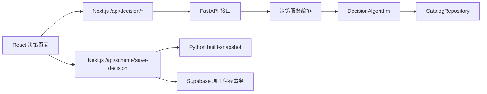

# Python 后端与算法替换

现有 Next.js 服务负责经验库、台账及持久化，并为 Python 提供带内部认证的资料快照。D1 默认算法为 `app.algorithms.configurable:create_algorithm`；显式本地测试使用 PGlite，正常模式使用 Supabase。新增 Python 服务负责决策计算，接口和算法实现相互独立。现有 Codespaces Python 直接运行，不创建虚拟环境，也不安装大型机器学习框架。

## 启动

首次安装缺少的 Python 依赖（使用当前 `python3`，不保存下载缓存）：

```bash
pnpm backend:install
```

同时启动前端和 Python 后端：

```bash
pnpm dev:d1
```

- 系统页面：`http://localhost:5000`
- Python 健康检查：`http://127.0.0.1:8000/health`
- 接口文档：`http://127.0.0.1:8000/docs`
- OpenAPI 契约：`http://127.0.0.1:8000/openapi.json`

连接数据库时执行 `pnpm dev:all`。联合启动自动为 Next.js 与 Python 生成内部资料密钥。也可以分别执行 `pnpm backend:dev` 和 `pnpm dev`，但需在两边配置相同 `DECISION_CATALOG_API_KEY` 和正确 `DECISION_CATALOG_URL`。仅启动 `pnpm dev` 时，算法请求仍需要已有的 Python 服务；连接失败会明确报错，不自动切换到浏览器规则。

需要指定另一已有解释器时，可在终端 `export BACKEND_PYTHON=/path/to/python3`；`dev:all` 也会读取 `.env.local` 中的该配置。`backend/requirements.txt` 锁定本次测试的依赖，`requirements.in` 记录直接依赖范围。测试使用标准库 unittest，没有额外安装 pytest。

生产部署分别运行 `pnpm backend:start` 和构建后的 Next.js。Python 默认只监听 `127.0.0.1`；不同容器部署时按实际网络设置 `BACKEND_HOST` 和 `DECISION_BACKEND_URL`。

## 目录与职责

| 位置 | 职责 | 后续替换方式 |
|---|---|---|
| `backend/app/api/decision.py` | 请求入口，声明 URL 与输入/输出模型 | 保持接口契约即可复用前端 |
| `backend/app/models.py` | Pydantic 领域及 HTTP 契约，输出 camelCase | 与 `src/lib/types.ts` 保持一致 |
| `backend/app/services/decision.py` | 编排推荐、设计、校核、报告及保存快照 | 不直接依赖某个算法实现 |
| `backend/app/algorithms/base.py` | `DecisionAlgorithm` 协议 | 新算法实现此协议 |
| `backend/app/algorithms/reference.py` | 当前项目规则的 Python 实现 | 可保留作回归基准，或配置新实现 |
| `backend/app/algorithms/registry.py` | 读取配置并加载算法工厂 | 无需修改路由或页面 |
| `backend/app/repositories/catalog.py` | 模板及工作面数据访问接口、JSON 实现 | 可注入数据库/API 实现 |
| `backend/data/decision.json` | 从现有工法/支护参考数据导出的初始目录 | 更换文件或替换 repository |
| `src/server/decision-backend.ts` | Next.js 到 Python 的连接、内部认证和超时处理 | 更换后端地址即可 |
| `src/lib/decision-adapter.ts` | 浏览器计算通道适配 | 默认 Python；显式 mock 仅用于离线演示 |



保存接口归属于 `/api/scheme/*`。`/api/decision/*` 仅作 Python 计算接口代理，修正了原先把保存接口放在该前缀下的问题。所有计算都走同一个配置的算法，保存时不会换用另一套 TypeScript 计算结果。D1 每次请求读取并冻结一份资料，版本包含内容摘要；后续步骤若版本变化返回 409，要求重新匹配。

## 接口

浏览器始终使用同源 URL，跨服务访问由 Next.js 完成，无需在浏览器配置 Python 地址或 CORS。

| 方法 | 路径 | 用途 |
|---|---|---|
| GET | `/api/decision/meta` | 工作面、里程选项及算法信息 |
| POST | `/api/decision/synchronize` | 按工作面、精确里程和查询时间读取采集资料，返回冲突/缺项/来源 |
| POST | `/api/decision/support-options` | 查询同优先级完整模板，供人工确认 |
| POST | `/api/decision/preview-rule` | 对输入条件预览规则命中，未写入数据库 |
| POST | `/api/decision/infer-methods` | 地质参数 → 候选工法和推荐标记 |
| POST | `/api/decision/design-support` | 地质参数和选定工法 → 四构件设计、评估、成拱参数 |
| POST | `/api/decision/recheck-safety` | 按当前修改后的构件配置重新评估 |
| POST | `/api/decision/generate-scheme` | 生成报告预览 |
| POST | `/api/decision/build-snapshot` | Python 的服务间接口，重新计算本次所有版本，供保存事务使用；不通过 Next.js 浏览器代理公开 |
| POST | `/api/scheme/save-decision` | Next.js 保存报告及台账，沿用原数据库事务 |

输入校验覆盖字段类型、有限数值、数值范围、未知字段、重复或缺少构件。前端也通过 Zod 校验后端响应。后端未启动、超时、无效 JSON、无效计算结果都返回明确错误，不静默降级。

支护数值变化后旧结果失效，需点击重新检查；期间报告生成按钮禁用。D1 尚无响应模型与判据，明确返回 unavailable、空分数、空雷达图和空成拱参数。推荐项直接使用算法返回的 `matched`，不再由前端按围岩等级重新选定。成拱参数和报告也来自 Python。

## 显式旧参考算法的范围

仅在显式配置 `app.algorithms.reference:create_algorithm` 时使用旧参考算法，它是项目已有 UI 规则的移植，**不是通过试验标定或规范验证的工程设计模型**：

- 工法推荐按围岩等级选择，参考分数沿用现有 98/60/45；其余输入参数被校验和记录，但不虚构它们对评分的影响。
- 支护设计仅提供现有 IV、V 级围岩的模板。其他等级的设计请求明确返回不支持，避免把 IV 级模板套用到未知地质条件。
- 支护评估按四构件相对模板的比例计算参考评分，分项图也只是演示指标。不是实际荷载、承载力或规范安全系数计算。
- 成拱高度、释放率、封闭时机沿用模板常量，不声称实现了 PINN 或其他物理模型。
- 报告显示参考配置，不擅自确定实际施工进尺、装备数量或爆破设计参数。

界面和报告展示算法 ID、版本及“参考规则演示”。评分说明明确标记未作工程校核。`reference` 标记由服务端算法实现确定，客户端不能把模拟数据标记成真实结果。

## 替换为自己的 Python 算法

例如新增 `backend/app/algorithms/company_model.py`：

```python
from app.algorithms.base import DecisionAlgorithm
from app.repositories.catalog import CatalogRepository


def create_algorithm(repository: CatalogRepository) -> DecisionAlgorithm:
    return CompanyDecisionAlgorithm(repository)
```

`CompanyDecisionAlgorithm` 实现 `base.py` 中的 `info`、`infer`、`design`、`assess`、`mechanism`、`report`。`design(request, values=None)` 的可选 values 用于重放人工调整，必须保留用户提交的构件数值，不能在保存时悄悄改写。结果通过相同 Pydantic 模型输出。

配置 `.env.local` 后重启 Python 服务：

```dotenv
DECISION_ALGORITHM_FACTORY=app.algorithms.company_model:create_algorithm
```

路由、前端页面、保存接口和数据库结构无需因此修改。`backend/tests/custom_algorithm.py` 是可运行的替换示例，测试验证配置工厂后推荐结果会变化。

每次修改算法行为或模板时更新 `info.version`。前端在推荐、设计、校核、报告阶段检查算法版本；保存快照也校验生成时的算法标识，版本变化时要求重新推理，避免混合多套模型结果。版本号应唯一对应一套模型和参数。

如果改用已有的远程决策后端，只需保持相同接口与返回结构，并设置：

```dotenv
DECISION_BACKEND_URL=https://your-decision-service.example
DECISION_BACKEND_TIMEOUT_MS=30000
```

如原有服务接口格式不同，可在 Python 路由/适配算法内转换到当前契约，或修改 Next.js 传输适配层；不需要逐个改页面组件。已有 Next.js 经验库/台账业务并不因此迁移到远程服务。

## 替换数据来源或整个应用

D1 默认 `HttpCatalogRepository` 从 Next.js 内部接口读取数据库快照；规则和完整模板的启停会影响下一次匹配。`JsonCatalogRepository` 仅用于显式旧参考算法或注入的测试。后续实现 `CatalogRepository.read() -> Catalog`，从数据库、地质平台或其他服务返回同样的数据结构，然后在应用工厂中注入：

```python
app = create_app(repository=YourCatalogRepository())
```

如该入口放在 `backend/company_app.py`，可设置 `BACKEND_ASGI_APP=company_app:app` 使用它。API 和算法协议不变。

仅更换 JSON 文件可设置 `BACKEND_CATALOG_PATH`。`pnpm backend:export-catalog` 可以从现有 `src/data/decision.ts` 重新导出参考目录，会覆盖 `backend/data/decision.json`，不应拿它覆盖自己维护的真实数据。

`DECISION_BACKEND_API_KEY` 可设置服务间认证，Next.js 自动附加内部请求头，浏览器不持有密钥。建议继续使用 Next.js 同源代理；如部署层直接把该前缀转给 Python，须处理同样的服务间认证与错误契约。

## 测试

```bash
pnpm backend:test
pnpm test:decision-contract
pnpm test:decision-api
pnpm test:db
pnpm ts-check
pnpm lint:build
```

- Python 测试覆盖接口、参考规则、调整后的重新评估、无效输入、版本冲突和算法替换。
- 契约测试实际调用 Python ASGI 应用，再用前端 Zod 校验响应；不需要启动监听端口。
- 代理测试覆盖错误状态、超时、内部接口限制和保存输入一致性。
- 数据库测试使用已生成的 Python 快照验证原子保存和回滚，不依赖运行中的 Python 服务或远程数据库。

Supabase 持久化仍需按 [数据库部署说明](database.md) 配置并迁移；没有数据库时可运行完整决策计算与报告预览，保存会明确显示未保存。

## 设计参考

接口拆分沿用 [FastAPI APIRouter](https://fastapi.tiangolo.com/tutorial/bigger-applications/) 和[响应模型校验](https://fastapi.tiangolo.com/tutorial/response-model/)的组织方式。目录划分和算法插件协议是本项目的工程选择，不是框架强制要求。


## D1 契约变化

工法推荐允许零个或多个 matched，并返回状态、规则版本与原因；不再要求唯一推荐。支护构件包含结构化参数，conf 可为空；评价的 score/radar 与成拱参数可以为空，空值不能当作 0 或通过。旧参考算法的分数仍可读取，但新界面只标为旧版参考。

完整模板通过 code/version 选择，并贯穿重新检查、报告和保存重放。保存重放校验规则/模板摘要，版本变化返回 409；缺少旧版本时不会改用新版本。D1 先采用冲突后重新匹配，尚不提供跨版本重算页面。

维护接口位于 `/api/knowledge/decision-catalog`，内部读取接口位于 `/api/internal/decision-catalog`。后者需要 `X-Catalog-Key`，不会通过浏览器的决策代理公开。完整运行、临时数据与浏览器测试见 [d1.md](d1.md)。

## D2 响应提供器与分项评价

`DECISION_RESPONSE_FACTORY` 独立于工法/支护算法，默认 `app.algorithms.response.base:create_unavailable`；通过 ResponseProvider 接入真实模型，无需替换页面。`pnpm dev:d2` 才显式加载合成提供器及测试判据。输入含当前完整支护、工作面/里程和 evaluationContext（sectionId、stage、displacementReference），输出带模型版本、输入摘要、单位、来源与缺项。默认 5 秒等待、4 个并发任务；远程适配器还须自行设置网络/计算超时。

判据与模型版本进入算法摘要，修改后后续步骤返回 409；服务端重放每次调整，在 schemaVersion=3 报告与 revision 的 safety_snapshot 中保存响应、判据、初始/当前评价与来源。没有工程模型时不可当作工程安全评价。实际配置、适用范围、公式及网页体验见 [D2 说明](d2.md)。
