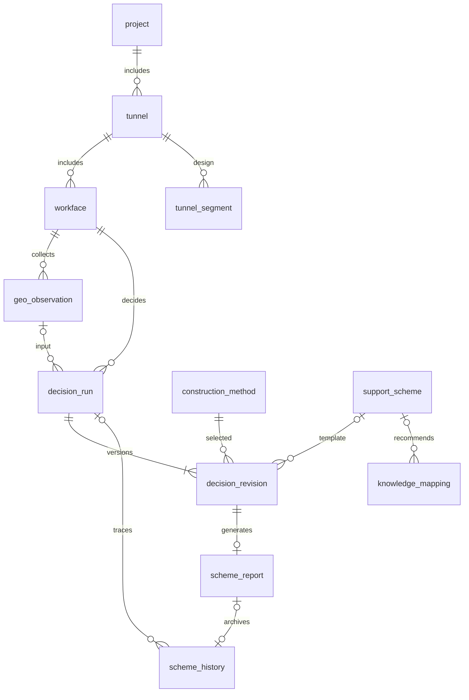

# 数据库部署与数据契约

采用 PostgreSQL / Supabase，14 张业务表，保留原有四张表及旧字段。D1 增加 `decision_rule`，通过 004、005 迁移扩展完整规格、资料版本和无评分的快照保存。`schema_migration` 记录迁移版本和校验和，不属于业务表；原 `health_check` 不参与业务链路。

## 部署

1. 将 `.env.example` 复制为 `.env.local`，填写连接参数。
2. `DATABASE_URL` 使用有建表权限的 PostgreSQL 管理连接，仅供初始化脚本使用。不要把数据库密码写入代码。
3. `COZE_SUPABASE_URL`、`COZE_SUPABASE_ANON_KEY`、`COZE_SUPABASE_SERVICE_ROLE_KEY` 供 Next.js 服务端使用。新表启用 RLS，当前内部应用由服务端的 service role 访问；密钥不得使用 `NEXT_PUBLIC_` 前缀。
4. 执行下列命令，然后重启应用：

```bash
pnpm db:plan
pnpm db:migrate
pnpm db:seed
pnpm dev
```

`db:plan` 仅列出本地 SQL 文件，不连接数据库。`db:migrate` 执行尚未记录的迁移，每个文件一个事务；文件执行后不能改写，需要新增后续迁移。脚本有迁移锁，失败时回滚当前文件。SQL 文件位于 `src/storage/database/migrations/`，也可用于人工审查。

没有数据库配置时，经验库和台账继续显示内置演示数据；保存方案返回 HTTP 503，页面显示未保存。配置后读取数据库中的实际内容，空库不会自动补种子。

迁移保留旧记录，不根据日期/里程删除或合并数据。已有表必须符合仓库原始四表结构；初始化前应备份已有数据库。已有四表的 RLS 策略保持原状；第一批新增九表和 D1 规则表无匿名访问策略。当前应用的访问权限仍由部署环境控制，本次不新增用户登录体系。

## 业务表

| 表 | 用途及关键关联 |
|---|---|
| `project` | 工程，唯一 `code` |
| `tunnel` | 主洞/平导，通过 `project_id` 关联工程 |
| `workface` | 工作面，通过 `tunnel_id` 关联洞线；`code` 对应现有工作面选项 |
| `tunnel_segment` | 纵断面设计分段，记录数值里程、设计长度、设计版本和原始展示快照 |
| `equipment` | 装备库，保持原名称、型号、数量、用途、阶段字段 |
| `construction_method` | 标准工法，唯一编码、版本、适用条件和数值参考指标 |
| `support_scheme` | 标准支护模板，保留展示字段，增加版本及 `parameters` 结构化参数扩展 |
| `knowledge_mapping` | 地质与方案映射，增加 `conditions` 扩展和可为空的模板主键引用 |
| `decision_rule` | 可执行工法/支护映射条件、排除项、优先级、引用模板和版本；同编码只启用一个版本 |
| `geo_observation` | 地质采集记录，关联工作面、数值里程、采集时间、来源；`params` 遵循 `GeoParams` |
| `decision_run` | 决策任务，保存输入快照、工作面、模式、通道、算法版本；实测记录引用可为空 |
| `decision_revision` | 每次初始设计、改选工法后设计、人工微调与重新校核的版本，保存候选工法和支护/安全评估快照 |
| `scheme_report` | 最终报告，关联具体决策版本，独立保存内容和唯一编号 |
| `scheme_history` | 兼容旧台账；新增任务/报告/工作面/工法引用、来源、数值进尺和循环时长 |



主键用于关联和删除，`no` 只用于展示。知识映射和支护方案删除接口改为 `?id=<数据库主键>`；序号由数据库序列分配，避免并发 `MAX(no)+1`。迁移与初始化同步旧的 serial 序列，不重排已有编号，也不降低已使用的序列值。

## 初始化与旧数据

`pnpm db:seed` 从 `src/data/` 导入现有演示数据：1 个工程、2 条洞线、2 个工作面、52 个分段、3 种工法、9 种装备、8 条知识映射、7 个支护方案、23 条历史记录。不伪造实测地质记录或已执行的真实决策任务。

初始化使用稳定的 `seed_key` / 业务编码去重；旧版内置记录按已知特征认领，只补充来源键，保留原内容。相似的用户记录不自动合并。重复执行不会覆盖已有修改；删除种子后普通查询不会恢复，再次显式执行初始化则可能补齐缺失种子。

旧字段保持字符串兼容，不猜测复杂描述的单位或范围。历史字段先保留，已能明确解析的进尺和循环时长新增到数值列。新任务使用统一来源：`seed`=演示、`simulation`=模拟决策、`manual`=人工录入、`import`=批量导入、`legacy`=来源尚未确认的旧数据。

里程以米保存，原桩号保留在快照中；进尺为米，循环总时长为分钟，标准工法喷砼厚度为毫米。当前 `GeoParams` 中埋深单位为米、密度为 kg/m³、摩擦角为度、弹性模量为 GPa、黏聚力为 kPa、应力为 MPa；比例值和泊松比无量纲。支护调整沿用界面的数值单位（间距/喷厚/环距为 cm，锚杆长度为 m），快照包含每个构件的 `unit`。

部分原始分段的声明长度与起止里程差存在偏差，初始化保留原值，不静默修正；汇总分析前需确认工程里程与断链口径。映射文本可能指向多个方案，不据此猜测单一外键；`support_scheme_id` 留空，后续经业务确认再填写。

## 保存方案与报告追溯

`POST /api/scheme/save-decision` 请求经过 Zod 校验。服务端调用配置的 Python 算法重新生成支护及评估快照，不信任客户端提交的评分或来源标签。当前默认算法为 `reference-rules:1.0.0`，入库标记仍为 simulation/mock；传输走 Python 不代表算法已经过工程标定。默认参数即使选择“联合感知”，也不会伪装成实测采集记录，`geo_observation_id` 留空。

数据库 `save_decision(jsonb)` 函数使用一个事务写入任务、所有调整版本、报告、台账。任何一步失败均回滚。相同 `requestKey` 及内容的重试返回原报告；同一键提交不同内容返回冲突。正式编号和保存时间由数据库生成，统一使用北京时间；预览编号不作为正式编号。

保存的是设计方案，当前没有输入实际施工进尺和最终衬砌类型，因此台账显示进尺 `—`、衬砌 `待确定`，起止位置均为设计点桩号。不能据此计算实际施工进度。台账标注“模拟方案”，展开后可通过 `GET /api/scheme/reports/<uuid>` 查看保存快照。

输入、工作面、里程变化会使旧推理结果失效；报告保存固定的生成快照。报告和历史版本不会因模板更新而重新计算。当前版本在用户点击保存时提交本次流程的全部调整记录；浏览器刷新前未保存的流程不落库。输入改变后重新推理视为新的决策，不与旧任务混合。

标准工法卡片读取数据库；决策流程现通过 Python 服务计算，工作面下拉项从 Python 元数据接口获取。默认算法和目录仍是项目参考规则/静态数据，真实地质采集及总览真实统计尚待接入。Python 算法替换方式见 [后端说明](backend.md)。报告文件地址可为空，本次未生成 PDF。

## 验证

```bash
pnpm test:db
pnpm ts-check
pnpm lint:build
```

`test:db` 使用 PGlite 在内存中运行真实 PostgreSQL 语法与 PL/pgSQL，不需要 Docker、数据库密码或网络。覆盖全新建表、旧四表升级、Drizzle 列契约、重复初始化、主键序列、外键约束、原子保存、幂等重试及失败回滚。Supabase 部署的角色授权、RLS、PostgREST API 和生产网络仍需部署后验证。


## D1 本地验证与数据库接入

`pnpm dev:d1` 使用已有 PGlite 依赖和 `.local/decision-test`，这是显式隔离测试模式，不会写入 Supabase。资料由 `pnpm d1:fixtures` 生成；重复执行保留既有内容和启停状态。默认数据库模式没有连接配置时返回明确错误，不自动切换数据源。

004/005 迁移提供 `publish_decision_catalog(jsonb)` 和 `set_decision_catalog_enabled(...)`：发布为整批事务；同编码同版本内容不可覆盖；新版本启用时停用该编码的其他版本。旧的自由文本映射和未补齐结构化规格的模板不会自动进入新算法。

`scheme_history.score` 允许空值；D1 的评价状态为 unavailable，旧分数不改写。调整版本另存完整模板和规则快照；采集记录引用由服务端验证后关联，报告内容保留当时版本。实际 Supabase 角色、RLS、PostgREST 仍需在部署环境验证。

## D2 追加迁移 008

新增第 15 张业务表 `evaluation_criterion`，保存不可覆盖的编码/版本、启停与完整判据 JSON。发布和启停由事务函数执行，同编码只启用一个版本；匿名角色无执行权限。`read_decision_catalog()` 同一 SQL 快照读取规则、模板、采集记录和判据。`save_decision()` 保留无评分情况的 satisfied/unsatisfied/unavailable 评价状态，报告 JSON 与 safety_snapshot 保存完整响应/判据/口径。旧报告及旧分数仍兼容。

本地 `dev:d2` 自动迁移并初始化明确标记的合成判据，正式库仍需显式执行迁移；没有验证实际 Supabase。响应案例尚无真实资料，24 组测试用例在版本化测试文件中，不冒充工程样本表。
