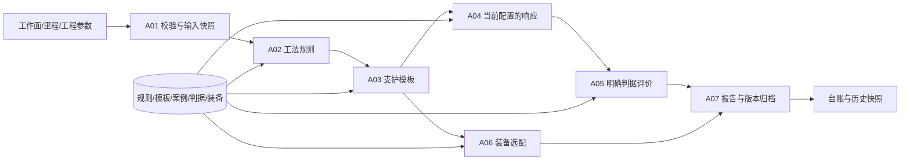

# 钻爆法隧道智能配置系统：算法与功能实施方案（讨论稿）

版本：v0.3｜日期：2026-11-03｜状态：D1/D2 已实现并完成本地验收；D3/D4 待实施

本文件用于先确定“系统应该怎样计算、怎样操作、怎样验收”，再逐步实现代码。可以直接修改本文件中的范围、规则、输入输出和验收例子；后续开发以确认的版本为依据，而不是只根据页面截图猜测算法。

用户已授权按本方案实施第一阶段，并允许构建算法和合成测试资料。D1 已实现规则匹配、完整支护模板、采集同步、资料维护及本地保存闭环；详见 [D1 使用说明](d1.md)及[验收记录](d1-verification.md)。D2 新增响应提供器、同口径分项变形评价、初始/当前对比图和评价快照；运行与替换见 [D2 说明](d2.md)。下文保留原设计讨论过程，实际完成范围以阶段记录为准；D3/D4 仍待实施。

## 1. 阅读与修改方法

### 1.1 编写依据

- 需求来源：[《钻爆法隧道智能配置系统功能与算法说明》](钻爆法隧道智能配置系统功能与算法说明.docx)，重点对应第 2—9 节。
- 实现依据：当前项目的 Python 算法协议、前后端类型、数据库定义、决策页面、经验库和台账代码。
- 现有接入说明：[backend.md](backend.md)；数据库说明：[database.md](database.md)。

原说明书作为业务需求参考，不代表其中列出的候选模型已经确定采用。本稿优先把说明书中的规则、数据和操作流程变成可实现、可测试的定义。

### 1.2 怎样逐步改成你需要的方案

1. 先看第 3 节的功能清单，把不需要的项目标为“暂缓”，把缺少的项目补入。
2. 对需要的项目，修改第 4 节对应算法的输入、处理规则、输出和例子。功能编号保持不变，方便追踪。
3. 在第 11 节记录你的选择。尚未提供的工程控制值、公式和真实样本保留“待提供”，不由开发人员猜测。
4. 每次讨论形成一个版本，例如 v0.2；注明本次修改哪些功能、哪些验收例子。
5. 进入代码实现后，每个功能提交对应测试和页面证据，再将状态改为“已实现”或“已验收”。

建议每项需求使用以下小模板，后续你也可以直接按这个格式提出修改：

```text
功能编号：A02
我要的行为：……
不需要的行为：……
输入例子：……
期望结果：……
异常时怎么办：……
页面放在哪里：……
是否有真实数据、公式或规则依据：……
```

### 1.3 “真实实现”的三个层次

| 层次 | 本项目中的含义 | 怎样证明 |
|---|---|---|
| 可用的软件实现 | 页面请求实际后端；后端实际读取数据库、执行规则、计算并保存结果 | 接口、数据库和浏览器联调通过 |
| 使用真实资料计算 | 使用有来源的工程输入、经确认规则、支护资料或响应样本 | 数据来源、版本、单位和适用范围可以追溯 |
| 工程方法经过验证 | 模型误差、控制条件和适用工况经过独立验证 | 工程案例、验证数据及专业确认 |

第一层可以先完成。AI 生成的临时数据用于检验软件流程，不能单独证明第二、第三层已经完成。规则匹配和明确判据比较本身可以是真实执行的算法，并不要求一开始就训练神经网络。

### 1.4 与原说明书的对应关系

| 原说明书章节 | 本稿对应功能 | 本稿补充的可实现细节 |
|---|---|---|
| 第 2 节：统一输入 | A01 | 定位查询、冲突、来源、重置与结果失效 |
| 第 3 节：工法选配 | A02 | 条件格式、优先级、并列、排除与无匹配 |
| 第 4 节：支护推荐 | A03 | 完整构件结构、数据库模板和微调边界 |
| 第 5 节：响应代理模型 | A04 | 无模型时的行为、可替换基线、离线交付与测试数据边界 |
| 第 6 节：安全评价 | A05/A07 | 分项和总体状态、缺项处理、重算与方案比较 |
| 第 7 节：方案和装备 | A06/A07 | 数量计算条件、版本快照、失败重试与历史归档 |
| 第 8 节：辅助页面 | A08/A09 | 规则维护影响算法、导入导出、统计来源与实际进度 |
| 第 9 节：模块对接和待定项 | 第 5—6、11 节 | 契约调整、版本、字段和待确认选择 |
| 用户提出的临时数据及软件测试要求 | A10、第 7—8 节 | 数据批次、数据库隔离、浏览器操作和可视化验收 |

## 2. 现有基础与说明书之间的差距

| 方面 | 当前代码已有能力 | 对照说明书需要补充或调整 |
|---|---|---|
| 后端框架 | FastAPI、算法协议、工厂加载、同源代理 | 可以复用，不必重写整个系统 |
| 输入 | 16 个 `GeoParams` 字段、工作面和里程、输入校验 | 增加实际采集查询和来源；按算法需要增加断面几何、评价阶段等，不固定为“18维” |
| 同步数据 | 当前按钮按工作面围岩级别回填默认参数 | 改为查询工作面、里程对应的采集记录，并展示时间、来源与缺项 |
| 工法 | 按围岩级别返回固定推荐和演示分数 | 读取数据库规则；支持排除、并列推荐、无匹配和推荐依据 |
| 支护 | IV/V 级参考模板、四项数值微调 | 从数据库读取完整构件规格，记录匹配方案和规则版本 |
| 响应预测 | 尚无真正独立的响应预测模块 | 增加预测接口层；先支持有明确来源的沉降、收敛结果或案例，再接训练模型 |
| 评价 | 相对模板比例形成的参考评分和雷达图 | 改为逐指标判据检查与“满足／不满足／无法评价”，不默认输出综合安全分数 |
| 成拱参数、置信度 | 参考常量和既有字段 | 未有方法时显示待接入或隐藏；不能为了兼容旧类型继续填固定数值 |
| 装备 | 装备库、报告中的工法配套文字 | 增加工序映射、可用设备筛选、数据齐全时的数量估算与缺口 |
| 保存与台账 | 任务、调整版本、报告的事务保存和历史快照查询 | 补充规则、模板、预测、判据、装备结果及版本的完整快照 |
| 总览 | 当前 `getOverview()` 返回静态数据 | 改为数据库汇总，并区分设计配置与实际施工进度 |

一个重要调整：现有接口强制“恰好一个推荐工法”，评价又强制包含分数和雷达图。这与说明书的并列推荐、无匹配、无法评价不完全一致。因此首次实施需要同时调整部分 Python 模型、TypeScript 类型、Zod 校验、页面和保存逻辑。完成这轮契约调整后，后续替换具体计算方法才可以主要集中在算法层。

## 3. 建议先构建哪些简单算法和功能

| 编号 | 功能 | 首个实现采用的方法 | 数据不足时的行为 | 实施顺序 |
|---|---|---|---|---|
| A01 | 参数同步与校验 | 定位查询、字段校验、单位转换 | 明确缺项，不把默认值标成实测值 | 第一阶段 |
| A02 | 工法推荐 | 可配置条件规则匹配和优先级排序 | 无匹配提示人工处理；并列时人工确认 | 第一阶段 |
| A03 | 支护推荐 | 硬条件筛选、规则引用完整支护模板 | 无完整模板就不自动补造规格 | 第一阶段 |
| A04 | 响应预测 | 统一预测接口；测试响应提供器；有样本后接案例检索基线 | 无模型、缺字段、超范围时显示无法预测 | 第二阶段 |
| A05 | 分项评价 | 预测或已知响应与配置判据逐项比较 | 保留已知结果，列出无法评价项 | 第二阶段 |
| A06 | 装备选配 | 工序—设备类型映射、条件过滤、可选能力估算 | 列需求和缺项，不默认给出数量 1 | 第三阶段 |
| A07 | 调整比较与归档 | 输入快照、版本差异、事务保存和重放 | 显示未完成评价，允许明确标记的待复核归档 | 分阶段完善 |
| A08 | 经验库维护 | 结构化表单、查询、导入校验、版本发布 | 错误定位到字段和导入行，不清空用户输入 | 第一阶段起 |
| A09 | 总览统计 | 数据库分类计数、长度汇总、实际进度汇总 | 无实际记录就显示无数据 | 第三阶段 |
| A10 | 临时数据与软件验收 | 固定随机种子生成场景数据，接口及浏览器测试 | 独立报告失败层次，不把跳过当作通过 | 全阶段 |

首轮不要求同时接入 SVM、随机森林、MLP、Transformer，也不要求在线启动 FLAC3D。先完成可解释的规则和数据闭环，再按真实数据情况替换 A03/A04。

## 4. 每个算法和功能的拟定行为

### A01：工程参数同步、校验与输入版本

**输入**：工作面、数值里程、查询时间，以及手动填写的工程参数。

**处理规则**：

1. 按工作面和位置查询 `geo_observation`。第一版建议只采用位置明确匹配的有效记录；不自动取“最近的一条”代替当前工况。
2. 相同位置多条有效记录，按不晚于查询时间的采集时间选择最新记录；同时间冲突则提示选择，不能任意取一条。
3. 如以后支持区间资料，需要明确起止里程和适用区间，再按包含关系查询。区间重叠应返回冲突，不静默覆盖。
4. 返回原始值、规范化值、单位、记录 ID、采集时间和来源。用户修改后标为人工修正，保留修改前值。
5. “重置参数”恢复本轮同步得到的初始快照；未同步时恢复页面初始值。所有下游结果失效。
6. 缺少当前步骤必需字段时阻止该步骤，并指出字段；与该步骤无关的缺项不应无条件阻断全部流程。

**字段与单位**：继续采用说明书约定的 m、kg/m³、GPa、kPa、MPa、°。支护页面的 cm 在算法边界按显式配置转换；不能对纯数字猜测单位。当前岩层厚度、地下水量等属于描述字段，如果模型需要数值，应新增数值与单位，而非直接把描述文字转成数字。

**待补字段**：断面宽高/面积、评价断面、施工阶段、位移基准；循环进尺和支护滞后距离仅在所选模型需要时增加。初支与二衬承担比例是否要求和为 1，应根据两者的定义和评价阶段确认后再设置约束。

**页面**：在现有“同步数据”按钮旁展示来源、采集时间、缺项和人工修正状态。

**验收**：切换到另一个位置时不能继续使用上个位置的采集值；输入变化后不能直接保存上轮报告。

### A02：工法条件规则匹配

**输入**：A01 的本轮工程输入，以及数据库中已启用的规则版本。

**简单算法**：先检查硬性排除条件，再匹配类别相等、允许值集合、数值区间等条件；按规则优先级排序。多条命中同一工法的规则汇总依据。优先级相同的不同工法并列，不用工法编号偷偷决定推荐结果。

以下是拟定的规则格式，仅说明软件结构。`test_section` 等是测试编码，不能直接作为工程规则发布：

```json
{
  "code": "test_rule_method_01",
  "kind": "method",
  "version": 1,
  "enabled": true,
  "priority": 100,
  "source": "simulation",
  "conditions": {
    "all": [
      {"field": "grade", "op": "eq", "value": "IV"},
      {"field": "section", "op": "in", "value": ["test_section"]}
    ]
  },
  "excludeAny": [
    {"field": "water", "op": "eq", "value": "test_excluded"}
  ],
  "methodKey": "bench",
  "reason": "测试规则：满足指定围岩与断面条件，且未命中排除条件"
}
```

**异常与边界**：

- 规则引用的必需输入缺失：该规则为“条件不足”，不按已匹配处理。
- 未知字段、未知运算符、区间上下界倒置：规则不能启用。
- 区间端点是否包含必须明确，例如 `[min,max)`；不得由前端、后端各自理解。
- 无推荐：返回空推荐集合及原因，页面允许对未被硬性排除的工法进行有理由的人工确认，并标记“规则未覆盖”。
- 并列推荐：均显示推荐，等待人工选择；已被硬性排除的工法默认不可选。

**输出**：每个工法的适用状态、命中与排除规则、理由、优先级、规则版本；独立返回用户最终选择和改选原因。

**页面**：使用“推荐／可选／不适用／条件不足”等文字，不显示未经定义的匹配百分数。“重新匹配”实际重新读取有效规则并执行请求。

**验收**：修改并发布一条规则后，下一次新决策的推荐改变；历史报告中的规则和结果保持原样。

### A03：从支护库推荐完整配置

**输入**：本轮工程输入、确认工法、有效支护规则和模板。

**简单算法**：按工法、围岩、断面、埋深等已定义条件过滤模板；按明确优先级选择。多个同优先级模板供用户确认。第一版不通过任意加权分数声称“最优”，也不分别拼出数据库中从未存在的四类构件组合。

| 构件 | 必须保存的结构化资料 | 页面首轮开放编辑 |
|---|---|---|
| 钢架 | 型号、纵向间距 cm | 纵向间距 |
| 喷射混凝土 | 强度等级、厚度 cm | 厚度 |
| 系统锚杆 | 类型、直径 mm、长度 m、纵向与环向间距 cm | 长度 |
| 超前支护 | 类型、直径 mm、长度 m、环向间距 cm、布置范围 | 环向间距 |

**资料处理**：已有 `spec/layout` 文本保留用于展示，但算法读取结构化规格；字符串不能明确解析的参数标为缺失，交由维护者补全。模板需要单独的“资料完整且已启用”状态。

**输出**：模板 ID、版本、匹配依据、四类完整构件、推荐初值、人工调整后的当前值。

**验收**：在经验库新增并启用适用模板后，无需改 Python 源码即可被新决策选中。无模板或规格不完整时返回原因，不沿用其他围岩等级的模板。

### A04：响应预测接口与可替换的简单基线

这一模块必须独立于 A03：推荐支护配置不等于已经预测其力学响应。

**统一输入**：工程参数、确认工法、完整当前支护配置、评价断面、阶段、位移基准、明确的单位和输入版本。

**第一批候选输出**：拱顶沉降 mm、水平周边收敛 mm。输出项还应包含成功状态、来源、适用性、模型/数据版本及失败原因。未提供的指标返回空值和原因，不填 0。

建议按数据条件选择不同实现，首轮并不全部实现：

| 数据条件 | 可以先做的实现 | 能验证什么 |
|---|---|---|
| 尚无真实响应样本 | 测试响应提供器：对已定义测试场景返回固定期望值 | 请求、单位、重算、判据、页面及保存是否正确 |
| 已有同口径的响应案例 | 先精确检索案例；匹配失败返回未覆盖 | 案例数据接入与结果追溯是否正确 |
| 有足够且经核验的案例 | 可选加权近邻基线，经过独立留出验证后启用 | 简单预测方法在限定数据范围内的表现 |
| 已有训练模型或远程服务 | 编写适配器，转换为统一响应格式 | 既有模型与系统流程的集成 |

**可选近邻基线的明确规则**：工法、断面类型、支护材料类型、阶段、位移基准等先严格分组；连续特征按已发布范围归一化，对工程参数和当前支护参数共同计算距离。`k`、权重、距离门槛、适用范围和单位随模型版本固定。距离为 0 时直接使用一致案例；同输入却有冲突结果需先处理资料冲突。否则按距离倒数归一化加权预测。缺特征、样本不足、没有有效邻居或超适用范围均返回无法预测，不静默外推。

上述基线是一项可讨论的低复杂度方案，并不保证工程预测精度。真实数据准备后再决定是否采用它或说明书中的 MLP、随机森林、SVR；不预先承诺误差水平。

**测试响应提供器的边界**：只能在显式测试配置下启用；带 `simulation` 和测试批次标记。没有数据时正式通道返回“预测模型未接入”，不能自动切换到测试提供器。AI 可以辅助生成场景和测试公式，但这些输出不是真实 FLAC3D 结果。

**验收**：修改四项支护数值时，请求携带新的完整配置，旧预测失效；在事先设计的敏感性测试案例中，新配置返回对应的新结果。真实模型不要求每次微小修改都必然改变数值，但必须实际使用当前输入，不能复用上轮结果。

**以后扩展承载指标**：钢架轴力和弯矩必须保留同位置配对信息；喷层应力、锚杆轴力保留分量、位置与定义。没有对应样本时不显示这些指标已经具备预测能力。

**真实模型的离线交付要求**：

- 整理有来源的样本，固定单位、评价阶段和响应定义，区分实测、数值模拟与合成测试资料。
- 按工程、工况组或相互关联的案例划分开发与独立验证数据，避免同一案例的近重复样本同时进入两边；归一化等预处理只从开发数据确定。
- 与简单检索或已有基线比较，分别记录沉降、收敛的平均绝对误差、最大绝对误差及不适用工况；允许误差目标待工程需求确认，不在本稿假定。
- 合成测试样本不作为真实模型精度合格的证明。先通过独立验证，再考虑接入正式预测通道。
- 交付模型文件或服务、输入输出清单、单位、类别编码、预处理参数、适用范围、数据版本、模型摘要与验证记录；页面操作时只调用，不现场训练。

### A05：按明确判据逐项评价

**输入**：A04 返回的响应，或有来源、同断面同阶段的已知响应；对应判据版本。

**最简单可用算法**：对已定义的变形指标比较 `响应值 <= 允许值`。上限、下限、区间判据分别使用明确运算符；必须先检查单位、阶段、断面和位移基准相容。不能拿未对齐的数值直接比较。

**分项状态**：满足、不满足、无法评价。另以“待更新／计算中／请求失败”表示界面计算状态，避免与评价结论混在一起。

**总体状态**：

1. 任一已知必需项不满足：总体为“不满足”，同时保留其他缺项。
2. 没有已知不满足项，但缺少任一必需结果、有效判据或必要资料：总体为“无法评价”。
3. 已定义评价范围内的全部必需项均有结果且满足：显示“该范围内满足”。
4. 没有定义任何必需项：无法评价，不按空集合判为通过。

仅有变形指标时，总体名称为“变形控制评价”；不能升级成“方案安全”或“支护承载通过”。本期不新增承载公式；待截面、材料、控制条件和计算方法确认后另立条目。

**演示用验收例子，数值均非工程控制值**：

| 响应与判据 | 期望结果 |
|---|---|
| 测试沉降 8 mm，测试上限 10 mm | 该测试项满足 |
| 测试沉降 10 mm，运算符为 `<=`，测试上限 10 mm | 边界满足 |
| 测试沉降 12 mm，测试上限 10 mm | 该测试项不满足 |
| 沉降缺失或未配置有效控制值 | 该项无法评价 |
| 沉降不满足、收敛缺失 | 总体不满足，同时列出收敛缺失 |
| 沉降满足、必需的收敛缺失 | 总体无法评价 |

**页面**：以明细表展示指标、响应值、单位、控制条件、依据、状态、原因；配实际值与控制值的对比图。综合分数、雷达图、置信度和成拱参数没有确认方法时隐藏或显示待接入。

### A06：装备筛选、数量估算与缺口

**输入**：确认工法、施工工序、装备库、现场可用数量、作业空间和可选的作业量/能力/计划时间。

**简单算法分两步**：

1. 配置“工法/工序 → 必需装备类型”映射。按空间适配、工序适配、设备状态等条件筛选，输出候选设备和缺失资料。
2. 只有同一工序的作业量、单台能力、时间窗口及利用系数齐全时，才执行数量估算。单台能力若为 `m³/h`、作业量为 `m³`、时间为 `h`，可采用 `建议台数 = ceil(作业量 / (单台能力 × 可用时间 × 利用系数))`。不同工序不能共用不匹配的单位和能力定义。

以上是作业能力的算术估算，不自动解决全工序排程、运输拥堵或爆破组织。利用系数不能由开发人员随意设定；取值来源随记录保存。数量缺口为 `max(建议台数 - 已确认可用台数, 0)`；缺少现有数量时显示“库存未确认”。

**测试例子**：仅用于软件验收，测试作业量 100 m³、单台能力 10 m³/h、时间 5 h、利用系数 1，则建议 2 台；确认可用 1 台时缺口 1 台。这些数值不是现场配置建议。

**页面**：报告中展示工序、设备类型、候选型号、建议数量、可用数量、缺口和计算依据。只知道设备类型时保留清单，数量显示待确定。

### A07：人工调整、方案对比和可追溯归档

**拟定操作链**：推荐初值 → 人工修改四项数值 → 旧预测与评价待更新 → 点击重新评价 → 查看前后差异 → 生成报告 → 保存台账。

说明书采用点击“重新校核”后计算；当前代码会在修改后自动发起延迟重算。建议首轮按说明书改为手动确认重算，避免计算频繁。是否保留自动重算作为可选项，见第 11 节。

**保存内容**：工程输入及来源、用户确认工法与原因、推荐初值和最终完整支护、每次调整、预测、判据与评价范围、装备清单、缺项、所有相关版本和测试标记。

**版本规则**：一次决策固定使用一组输入、规则、模板、预测模型和判据版本。新决策读取最新已启用版本；进行中的任务和保存重放使用固定版本。旧版本不能获取时明确要求重新决策，不能用最新版悄悄替换。历史查看只读快照；“按新版本重新评价”生成关联的新任务，不覆盖原记录。

**归档规则**：输入合法、配置完整、计算状态已结束后可生成报告；判据结论为不满足或无法评价，也可以保存为“待复核方案”，报告显著保留结论与原因。请求仍在进行或因改参尚待更新时不允许生成当前报告。模型未接入属于已知的“无法评价”，不同于仍显示旧结果。

**幂等与失败**：延续现有事务保存；相同请求键和内容不重复保存，不同内容冲突；失败保留报告可重试。历史报告编号、时间由数据库生成。仅做设计配置时不生成实际施工进尺或循环时长。

**页面**：调整前后参数差异表、变形指标前后对比、评价状态变化、规则/模型版本、保存成功后可直接查到的台账链接。

### A08：让数据库维护真正影响算法

**规则维护**：新增、修改为新版本、启用/停用、条件校验、规则预览。预览输入一组条件，返回会命中的规则及原因；只有启用的有效版本参与新决策。

**支护维护**：沿用现有分类、搜索、导入和管理入口，增加结构化规格和完整性校验。导入先预览，报告错误行；拟定一批导入校验全部通过才落库，失败不留下半批数据。导出使用带格式版本的 JSON，保证可以按相同契约重新导入。

**装备维护**：保留现有名称、型号、数量等字段，补充类型、能力及单位、空间限制、可用状态。库存数量和算法建议数量是不同字段。

**重置语义**：只恢复筛选和显示，不清空持久化数据；停用已被引用的规则或模板不破坏历史快照。

### A09：总览数据库统计与可视化

**简单算法**：按洞线、里程范围、工法、支护模板和来源分组计数或汇总数值；总览不重新运行推荐和评价。

- 纵断面色带读取 `tunnel_segment`，保留原始桩号、设计版本和声明长度。
- 工法/支护设计分布可按已选定分段长度统计；重叠区段需要先确定有效设计版本，不能直接重复相加。
- 实际进度仅使用明确记录的实际施工区间。存在重复区间时按去重后的有效区间统计；反向推进、断链和超出工程范围的情况单独校验。
- 只有单个设计点、方案参考进尺或计划量时，不能把它们相加当作已开挖里程。
- 性能提升、效率改善等成效指标，没有真实对照数据时显示待接入，不从临时数据推断实际成效。

**页面**：保留主洞/平导切换和分段点击；柱状图、环形图、进度卡片明确标出“设计数据／实际记录／临时测试数据”的来源口径。

## 5. 数据库怎样扩充，尽量复用已有表

当前已有 13 张业务表。建议先评审下表；不是把所有可能的数据都立即拆成新表。

| 数据 | 建议位置 | 需要的工作 |
|---|---|---|
| 工程、洞线、工作面、分段 | 现有 `project/tunnel/workface/tunnel_segment` | 复用；补齐查询和统计 |
| 地质采集和手动修正输入 | 现有 `geo_observation.params` 与任务输入快照 | 补来源、查询逻辑和字段校验；新增参数不必然新增列 |
| 支护完整规格 | 现有 `support_scheme.parameters` | 明确结构化契约、单位、版本和启用状态；保留旧文字 |
| 装备能力和状态 | 现有 `equipment` | 可增加 `parameters` JSONB 和状态字段；不混淆库存与建议数量 |
| 工法、支护、装备映射规则 | 建议新增 `decision_rule` | 类型、编码、版本、条件、排除条件、目标、优先级、启用状态和依据 |
| 响应案例 | 建议新增 `response_sample` | 完整输入与配置、输出、阶段、位移基准、来源、批次和版本 |
| 评价判据 | 建议新增 `evaluation_criterion` | 指标、单位、适用条件、运算符/控制值、必需性、依据和版本 |
| 任务、调整、报告和台账 | 现有 `decision_run/decision_revision/scheme_report/scheme_history` | 扩展快照、评价状态、范围及来源；继续原子保存 |
| 模型版本说明 | 首轮可采用有版本的 manifest 文件 | 记录输入输出、编码、范围、数据版本、模型摘要及验证记录；需要网页管理时再考虑独立表 |

原 `knowledge_mapping` 主要是地质到支护方案的展示资料，不能直接假定每条都是完整的工法规则。若采用独立 `decision_rule`，经验库页面通过该服务维护可执行规则，旧映射先保留，避免同一规则维护两份。是否合并两类规则视图需要确认。

### 5.1 两项不能遗漏的兼容迁移

1. `scheme_history.score` 当前不能为空，保存函数还会提取评分。新方案没有定义评分时应允许空值，并新增评价状态、范围和摘要；历史分数保留为“旧版参考评分”，不能填 0 作为新评价的占位。
2. 预测、完整规格、判据、规则版本等需贯穿 Python 输出、Next.js 校验、保存事务和历史读取。仅往 JSONB 写额外字段，不代表已有页面和服务就会自动使用这些字段。

只追加新的 SQL 迁移，不改写已经发布的 001—003 迁移；旧报告继续可查看。新旧快照建议带 `schemaVersion`，由读取适配器处理。

### 5.2 来源与测试标记

原始资料来源、计算方法、是否测试是不同维度。建议分别保存 `inputSource`、`responseSource`、规则/模型版本，以及 `isTest/testBatchId`。AI 合成资料使用现有 `simulation` 等适当来源，不伪装为实测或 FLAC3D 资料；新增枚举值必须同步校验和迁移。

当前 `reference` 标记还关联入库的 `simulation/algorithm` 和 `mock/real`。后续应把算法状态、资料来源和传输通道分开表达；不能把 `reference` 改为 `false` 就宣称测试资料或工程结果已经真实可信。新标记必须由服务端校验和沿链路传递，不能信任浏览器自行声明来源。

## 6. 代码怎么组织，后续怎样替换

以下是拟定位置，不代表本轮已经创建这些代码：

```text
backend/app/algorithms/
  rule_matching.py       # A02 条件运算和排序
  support_matching.py    # A03 完整模板选择
  response/base.py       # A04 预测接口
  response/case_lookup.py
  response/test_provider.py
  evaluation.py          # A05 判据和汇总状态
  equipment_matching.py  # A06 筛选与能力估算
  configurable.py        # 组合上述模块，实现 DecisionAlgorithm
backend/app/repositories/
  ...                    # 读取已发布规则、模板、案例、判据
backend/app/services/
  ...                    # 固定版本、输入快照和流程编排
src/server/               # 经验库维护、保存、台账、总览业务
src/lib/                 # 类型、输入/响应校验、同源数据访问
src/components/          # 现有页面内增加结果与可视化
scripts/                 # 临时数据生成、导入、清理与验收脚本
tests/                   # 算法、数据库、接口和浏览器测试
```

继续遵循 API → services → algorithms/repositories 的分层。Python 的 repository 读取数据库通过服务端凭据或内部接口完成，页面不直接持有凭据；选择哪一种在实施时按现有部署确定。



**可以小改的情况**：以后替换同输入输出格式的规则实现、案例算法或模型适配器，只改对应模块和版本配置。

**需要联动修改的情况**：新增工程输入、构件类型、响应指标或评价语义时，同时调整契约、表单、服务和测试。第一次将演示评分升级为分项评价属于后一种情况；不承诺只继承一个类就能完全适配。

真实算法采用独立实现或组合各模块，不长期依赖参考类的评分方法。保存重放继续调用同一配置和版本的服务，不在数据库代码中复制公式；人工修改的合法数值原样保留，不支持时明确拒绝，不静默修正。

继续使用环境已有 Python，不建立虚拟环境。优先使用现有依赖；确需模型依赖时按已选方法增加，JavaScript 依赖仅用 pnpm 管理。

## 7. AI 临时测试数据方案

### 7.1 数据生成原则

- AI 负责辅助定义场景、边界和数据结构；脚本使用固定随机种子与固定基准时间，确保同一版本能够重复生成。
- 每批带 `testBatchId`、生成器版本、来源、预期结果清单和关联记录 ID 清单。工作面可用 `test_face_a`，种子键可用 `test:<批次>:<记录>`。
- 合法数据与故意无效的数据分开；错误数据只用于验证拒绝行为，不先灌入正式业务表。
- 有效测试对象建立完整外键关系；重复请求键按场景设计，不能所有场景共用一个键。
- 数值覆盖合法区间、边界和错误值，但不声称反映现场地质分布。允许值和测试响应都标为软件测试专用。
- 原始测试场景文件可提交版本管理；密钥、数据库连接、运行日志和临时截图不混入业务数据。

### 7.2 首批数据量建议

| 数据 | 建议规模 | 主要覆盖 |
|---|---|---|
| 测试工程/洞线/工作面 | 1 个工程、2 条洞线、2 个工作面 | 定位、筛选、隔离和切换 |
| 采集与手动输入场景 | 约 12 组 | 正常、缺项、冲突、过时记录、未知位置 |
| 工法规则 | 约 8 条 | 单命中、多命中、并列、排除、停用、无匹配 |
| 完整支护模板 | 约 6 套，另有不完整反例 | 不同适用条件、版本变化和构件完整性 |
| 测试响应案例 | 约 24 条 | 同工况不同支护、不同阶段、适用范围和缺失输出 |
| 测试判据 | 两个版本，覆盖两个变形指标 | 满足、边界、不满足、无法评价、版本变化 |
| 装备记录 | 约 8 条 | 可用、停用、空间不符、缺能力、数量不足 |
| 历史记录 | 约 10 条 | 不同日期、工作面、来源、状态和分页/筛选 |

规模只服务于功能覆盖，不等于模型训练所需样本量。自动化可在场景间组合输入，但不能仅靠增加随机记录数量代替明确的验收用例。

### 7.3 测试数据库与清理

1. 算法、SQL 约束和事务测试优先沿用已有 PGlite；它能验证本地 SQL 行为，不能替代实际 PostgREST 和页面落库测试。
2. 有独立开发/测试 Supabase 时验证远程部署，连接参数由环境提供，不写进文件。用户明确暂没有该实例，D1/D2 使用独立 PGlite 与实际 Next.js/Python 浏览器链路完成本地持久化联调。
3. 本地 SQL/页面测试与远程 Supabase 测试分开记录；前者可报告实际执行结果，后者在未提供实例前标为“未执行”。本地通过不证明 PostgREST/RLS 或远程部署通过。
4. 不把大批 AI 临时记录直接导入正式工程库。生成和导入先输出清单预览，再执行目标测试库的导入。
5. 清理只按测试批次及记录清单，检查是否有非测试对象引用后，在事务中按依赖顺序删除。禁止清表或按模糊日期范围删除。
6. `seed` 重复导入不覆盖手改内容；需要生成新版本时使用新的批次。测试结束可导出报告后清理测试批次。

未来生成、导入、清理命令及目标确认选项在脚本实现后写入本节；现在没有这些命令，不能照本稿假设已能运行。

## 8. 软件测试和页面可视化验收

### 8.1 测试层次

| 层次 | 主要检查 | 通过证据 |
|---|---|---|
| 算法测试 | 匹配、排序、单位、边界、评价汇总、设备估算 | 事先写定的输入输出与测试结果一致 |
| 接口契约 | Python、Next.js、TypeScript 对同一数据解释一致 | 实际响应通过契约校验；非法数据明确拒绝 |
| 数据库 | 迁移、版本、外键、幂等、回滚、旧数据兼容 | 真实 SQL 执行结果和记录核对 |
| 服务联调 | 改规则确实影响推荐；当前支护确实进入预测 | 请求、返回与固定版本可以对应 |
| 浏览器操作 | 实际点击、编辑、重算、保存、刷新、历史查看 | 可重复操作记录或浏览器自动化结果 |
| 可视化 | 图形与接口、单位、筛选条件一致 | 图表数值、表格、报告与数据库逐项核对 |
| 工程验证 | 对独立真实案例比较预测和方法适用性 | 单独的工程验证记录；不由软件测试代替 |

预期结果必须先写入场景清单，并包括手工可核对的小例子。不能只调用被测算法生成“正确答案”，再用同一算法验证自己。

### 8.2 关键场景矩阵

下表为完整目标矩阵。D1/D2 已执行部分用例，详见各阶段验收记录；装备、总览与按新版本另存关联评价仍属后续阶段，不将整表视为已通过。

| 编号 | 操作/场景 | 期望后端与数据库行为 | 页面及图形期望 |
|---|---|---|---|
| T01 | 同步有明确采集记录的位置 | 返回对应 ID、时间、来源和参数 | 显示来源，字段值与记录一致 |
| T02 | 切换至无记录的位置/相同时间冲突 | 明确无记录或冲突，不返回默认实测数据 | 提示缺项或要求选择，旧结果失效 |
| T03 | 唯一规则命中 | 返回该工法和命中理由 | 正确高亮；无固定百分比 |
| T04 | 两个工法同优先级 | 返回并列推荐 | 都有标记，等待人工确认 |
| T05 | 命中排除条件或无规则 | 排除不能被覆盖；无匹配有明确状态 | 不适用不可选；未覆盖可说明原因后人工处理 |
| T06 | 经验库新增/停用规则 | 新决策使用发布后版本 | 重新匹配结果改变，历史报告不变 |
| T07 | 缺模板/模板不完整 | 不生成不完整配置 | 显示具体缺失构件或字段 |
| T08 | 推荐后分别修改四项数值 | 保留当前值，清除旧预测与评价 | 差异高亮；重算前不能生成当前报告 |
| T09 | 修改后点击重新评价 | 提交新完整配置，返回对应测试响应 | 明细表和前后对比图更新，值与接口相同 |
| T10 | 测试响应等于/大于上限 | 按配置运算符判满足/不满足 | 比较图控制线正确，标签与表格一致 |
| T11 | 一个已知不满足且另一个缺失 | 总体不满足，同时记录缺项 | 缺失值为“—”，不绘制成 0 |
| T12 | 模型未接入/超范围/超时 | 返回明确原因，不自动使用演示预测 | 保留用户输入；不展示旧值为当前结果 |
| T13 | 设备能力齐全/不足/缺失 | 算出台数、缺口，或返回待确定 | 数量、单位和原因一致 |
| T14 | 生成并保存方案，再刷新页面 | 完整快照事务落库，编号一致 | 提示成功；台账能打开同一报告 |
| T15 | 重复点击保存/同键不同内容 | 同内容只保存一次；不同内容冲突 | 无重复行，失败可见且报告不丢失 |
| T16 | 人为制造保存中途失败 | 任务、版本、报告、台账全部回滚 | 不显示成功，不出现半条方案 |
| T17 | 修改模板、判据后查看旧方案 | 原始版本和结果不变 | 历史图表按快照显示，不按当前库重算 |
| T18 | 请求 A 未完成时修改输入并请求 B | 旧返回不能覆盖新一轮状态 | 页面只显示 B，或明确 B 待更新 |
| T19 | 台账日期/工作面查询和重置 | 查询结果及来源正确，重置不删数据 | 展开、收起和历史报告查看正常 |
| T20 | 支护库导入有一行错误 | 返回错误行，整批不落库 | 已填内容保留；正确导出可重新导入 |
| T21 | 主洞/平导切换与统计 | 只聚合目标对象的有效数据 | 色带、统计和图表一致，无测试数据混算 |
| T22 | 按新版本重新评价旧方案 | 新建关联任务，保留旧任务 | 可比较两版的输入、方法、响应和结论 |

### 8.3 四个主页面的验收重点

| 页面 | 建议展示 | 重点核对 |
|---|---|---|
| 系统总览 `/` | 纵断面、设计工法分布、真实施工进度 | 切换对象、长度口径、数据来源，不能用方案数代替进度 |
| 决策中心 `/decision` | 命中规则、完整构件、评价表、响应与限值比较、调整前后对比、装备清单 | 全流程实际操作，空值/单位/版本/状态清楚 |
| 经验数据库 `/knowledge` | 规则条件、版本、启用状态、支护规格、设备能力 | 保存后刷新不丢失，新决策确实读取新增资料 |
| 台账 `/scheme` | 输入及结果快照、评价摘要、版本、来源 | 查询、重置、展开、查看旧版、另存新评价 |

图表拟使用项目已有 Recharts；新增表单、对话框等复用 shadcn/ui。首期以指标对比柱状图/控制线和参数差异表为主；不为保留雷达图而编造六个指标。

浏览器验收应通过真实页面操作完成。若使用自动化工具，优先按可见按钮名称、表单标签和结果内容定位；不能只访问 URL 返回 200 就宣称按钮、数据库写入和图表都可用。

### 8.4 每次测试的交付记录

后续测试报告应记录：代码版本、文档版本、测试批次、规则/模板/模型/判据版本、目标测试环境、执行命令、通过/失败/未执行用例、数据库记录核对、页面截图或操作记录、残留问题和清理情况。日志与截图避免包含连接密钥。

目前已有 `pnpm backend:test`、`pnpm test:decision-contract`、`pnpm test:decision-api`、`pnpm test:db`、`pnpm ts-check`、`pnpm lint:build` 等检查入口。它们需要随新契约扩充；已有检查通过不等于本稿中的新功能已实现或已验收。

## 9. 建议的分阶段交付

| 阶段 | 完成内容 | 可供你验看的结果 | 进入下一阶段的条件 |
|---|---|---|---|
| D0：文档讨论 | 修改本稿，明确范围、判据来源和待定项 | 确认版文件与验收例子 | 本阶段需求达到可编码程度 |
| D1：规则与数据库闭环 | A01/A02/A03/A08，必要契约和数据库迁移 | 页面同步参数；改数据库规则后推荐改变；支护来自真实查询 | 规则、模板、来源与历史兼容测试通过 |
| D2：响应与评价闭环 | A04/A05，测试响应提供器及真实接口适配位置 | 修改支护后重算；显示分项、缺项、对比图；无模型时明确提示 | 确定性场景及页面流程通过；测试输出明确标记 |
| D3：方案、装备和总览 | A06/A07/A09 | 保存、刷新、查历史、装备缺口、数据库总览 | 事务、版本、页面与统计核对通过 |
| D4：真实样本与模型 | 有来源样本、离线验证、替换响应实现 | 同一页面调用真实模型；有独立误差与适用性记录 | 真实资料与专业验证条件具备 |

AI 临时数据和 A10 测试贯穿 D1—D3，而不是写完全部代码后才第一次联调。D1—D3 可以证明软件可用；D4 的工程可信度需要真实资料，不能用合成数据补足证明。

## 10. 首轮验收目标与暂缓范围

### 10.1 建议首轮达到的目标

- 用户能同步或录入一组带来源的条件，按规则得到可解释的工法候选。
- 用户能从数据库得到完整支护配置，修改四个已开放参数，并触发重新评价。
- 有有效响应和判据时按明确规则得到结论；没有资料时显示具体缺项。
- 报告汇总本轮配置、评价范围、装备需求和版本；保存成功后刷新仍可查到。
- 数据库维护确实影响下一轮决策；旧报告保持保存时内容。
- 每个关键操作有临时数据场景、期望结果和真实页面证据。

### 10.2 本稿建议暂缓的范围

PINN、Transformer 等复杂模型的同时开发；在线 FLAC3D 计算；未定义的综合安全评分、雷达映射、置信度、成拱高度；缺少资料的支护承载公式；全工序最优排程；复杂爆破设计；自动生成 PDF。后续需要时分别补输入、方法和验收标准，不以“智能”字样代替定义。

## 11. 需要你逐步确认的选项

不必一次答完；可以直接修改“你的决定”列，或按编号告诉我意见。

| 编号 | 要确认的问题 | 本稿建议 | 你的决定 |
|---|---|---|---|
| C01 | 首轮工法和支护是否先用规则与模板？ | 是，先做可解释的数据库规则闭环 | 待确认 |
| C02 | 哪些围岩等级和工法首轮必须覆盖？ | 保留现有三工法；支护先 IV/V，其他等级不自动套用 | 待确认 |
| C03 | 无匹配、并列与排除怎么处理？ | 无匹配说明后人工确认；并列人工选；硬排除默认不可选 | 待确认 |
| C04 | 第一批响应指标选哪些？ | 沉降、收敛；其他指标待样本齐备 | 待确认 |
| C05 | 没有真实模型时怎样展示？ | 正式通道显示未接入；独立测试通道演示完整流程 | 待确认 |
| C06 | 是否先采用案例基线？ | 有合格数据后先精确检索，近邻预测另行验证 | 待确认 |
| C07 | 四项支护修改后自动算还是点击算？ | 点击重新评价，与说明书一致 | 待确认 |
| C08 | 是否保留仪表分数和雷达图？ | 首期改为逐指标比较；映射明确后再恢复 | 待确认 |
| C09 | 控制值、阶段与依据由哪里提供？ | 使用你提供或确认的项目资料；当前待提供 | 待提供 |
| C10 | 评价不满足或无法评价能否归档？ | 可以，显著标为待复核，不当作已通过 | 待确认 |
| C11 | 装备首轮只列清单，还是同时估数量？ | 先清单；能力、作业量和时间齐全才估数量 | 待确认 |
| C12 | 哪些总览数据要先接数据库？ | 分段与设计分布先接；实际进度需实际施工记录 | 待确认 |
| C13 | 经验规则是否采用独立执行规则表？ | 采用，复用原页面入口，避免直接解释旧自由文本 | 待确认 |
| C14 | 是否有可用于页面持久化联调的数据库？ | 独立测试实例；凭据通过环境配置 | 用户明确暂无；D1 使用隔离本地 PGlite |
| C15 | 是否按 D1—D3 分批开发和验收？ | 是，每批先固定例子，再实现与联调 | 待确认 |

## 12. 版本和实施记录

| 版本 | 日期 | 本次变化 | 状态 |
|---|---|---|---|
| v0.1 | 2026-11-02 | 对照使用说明书与现有代码，提出简单算法、契约调整、临时数据和页面验收方案 | 初稿 |
| v0.2 | 2026-11-02 | 按用户授权实现 D1；使用合成规则、完整模板和采集记录完成本地 SQL、接口及浏览器闭环 | D1 本地验收通过 |
| v0.3 | 2026-11-03 | 实现 D2 响应提供器、分项变形评价、判据版本维护、对比图及评价快照 | D2 验收详见阶段记录；D3/D4 待实施 |

后续为每个 A 编号补充：对应代码文件、测试编号、实现提交、测试报告、验收意见。新增需求先在文件中明确语义，再进入实现，保持“文档—代码—数据—页面结果”可以逐项核对。

### D1 实施决定

C01/C03/C07/C10/C13/C15 按建议实施。C02 使用三类工法和 IV/V 级合成场景；C05/C08 在未接入模型时明确显示无法评价，不输出虚构评分或雷达图。以上为用户授权范围内的实现选择，可在后续版本调整。C04/C06/C09/C11/C12 属后续阶段，尚未完成。真实资料与工程判据当前均没有，测试资料不能作为工程有效性证据。

### D2 实施决定与追踪

用户继续授权按文件实施下一阶段，且没有真实数据或算法。C04 采用沉降、收敛；C05 使用显式 `dev:d2` 隔离测试模式；C08 采用指标明细与对比柱状图；C09 仅使用标明软件测试用途的合成限值，不宣称有工程控制依据。没有响应模型时正式模式仍明确不可评价，不自动回退。

A04 对应 `backend/app/algorithms/response/`；A05 对应 `evaluation.py` 和 `evaluation_criterion`；A07 本阶段只完成初始/当前对比、响应与评价快照。24 组预先列出的期望值位于 `tests/fixtures/d2-response-cases.json`，接口、SQL 与浏览器证据见 [D2 验收记录](d2-verification.md)。

采用透明的合成敏感性算术验证完整支护进入响应，而非训练模型或近邻预测；当前没有真实案例，不提前新增响应案例表。测试模型仅覆盖明确列出的 IV 级主洞台阶法、规格、阶段和范围；V 级等未覆盖情形返回不可用。D3 装备能力和总览、D4 真实样本及工程验证继续待实施。
